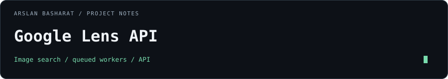

# Google Lens API



A self-hosted image-search service with an authenticated TypeScript API, Python browser workers, and queued processing.

[Latest release](https://github.com/arslanbasharat-o-o/Google-Lens-API/releases/latest) · [API reference](docs/api.md) · [Architecture](docs/architecture.md) · [Operations](docs/operations.md)

## What it does

- Accepts single-image, multisearch, and batch visual-search requests.
- Supports text prompts (`prompt` / `q`) alongside images for deep AI research and model identification.
- Captures dual-signal results: visual matches ("All") and generative multimodal reasoning ("AI Mode").
- Separates the Fastify gateway from Scrapling and Chrome workers with preemptive proxy authentication.
- Uses Redis Streams for queued work and result storage.
- Reaps browser child processes with container init (`tini`) for reliable long-term stability.
- Validates uploaded images and restricts remote-image fetch destinations.
- Provides offline adapters, fixture replay, and benchmarks for repeatable development.

## Stack

| Layer | Technology |
| :--- | :--- |
| API | Node.js 22, TypeScript, Fastify |
| Worker | Python 3.12, Scrapling, Chrome |
| Queue and cache | Redis Streams |
| Packaging | Docker Compose, npm, uv |

## Develop locally

Use the versions in [`.nvmrc`](.nvmrc) and [`.python-version`](.python-version), plus `uv`.

```bash
git clone https://github.com/arslanbasharat-o-o/Google-Lens-API.git
cd Google-Lens-API
nvm use
npm ci
uv sync --locked --extra dev
npm run build
```

Start an offline development instance:

```bash
API_AUTH_REQUIRED=false LENS_ADAPTER=mock QUEUE_BACKEND=memory npm start
```

This command is for local offline development. Use the authenticated production configuration for a network-accessible deployment.

## API at a glance

| Workflow | Endpoint |
| :--- | :--- |
| Single-image search | `POST /search.json` |
| Multisearch & AI mode | `POST /search.json` (with `prompt` or `q`) |
| Asynchronous job status | `GET /v1/jobs/:job_id` |
| Batch search | `POST /v1/lens/batch` |

Responses include both visual matches and AI research summaries (`ai_mode` / `ai_overview`). See [the API reference](docs/api.md) for request formats, authentication, limits, and error responses.

## Validate

```bash
npm test
npm run typecheck
uv run pytest -q
uv run mypy scrapling_worker
uv lock --check
npm run benchmark:offline
```

## Deploy

Copy [`.env.example`](.env.example) to `.env`, set the required authentication and provider settings, and follow [the operations runbook](docs/operations.md).

```bash
docker compose -f docker-compose.production.yml up -d
```

Deploy the API and Scrapling worker from the same published release. Version sources are [`package.json`](package.json) and [`pyproject.toml`](pyproject.toml). Live search availability depends on the upstream provider; offline test success is separate from live-search verification.

## Documentation

- [API contracts](docs/api.md)
- [Queue and worker architecture](docs/architecture.md)
- [Scrapling worker](docs/scrapling-worker.md)
- [RMA integration](docs/rma-integration.md)
- [Security boundaries](docs/security.md)

## License

[MIT](LICENSE).
