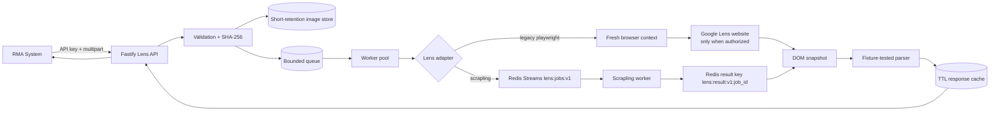

# Architecture

## Runtime flow



The Fastify API and synchronous admission worker remain one deployable process.
Scrapling execution is an external Redis Streams worker; explicit storage and
queue seams keep HTTP handlers independent from browser code.

## Components

1. **HTTP layer** (`src/http/app.ts`) exposes the SerpApi-compatible aliases,
   validates multipart bytes and search parameters, enforces API keys/rate
   limits, and keeps request bodies bounded.
2. **Image boundary** (`src/http/uploads.ts`, `src/storage/image-store.ts`)
   checks JPEG/PNG/WebP signatures, dimensions and pixel count, hashes bytes,
   and retains uploaded images only for a short configurable period. Production
   `FileImageStore` atomically writes `<image_id>` plus metadata beneath
   `IMAGE_STORAGE_DIR` and removes expired, over-limit, orphaned, or unsafe files.
3. **Remote URL boundary** (`src/services/remote-image.ts`) follows only
   bounded HTTP(S) redirects and rejects local, private, link-local and
   metadata address ranges before every fetch.
4. **Queue/worker layer** (`src/queue`, `src/workers`) applies admission
   control, bounded retries with jitter, dead-letter metadata and cancellation.
   `InMemoryJobQueue` is the offline default. `RedisJobQueue` provides a
   central Redis list for local admission, while `RedisStreamsJobQueue`
   implements `lens:jobs:v1`/`scrapling-workers` for external workers.
   `RedisJobPersistence` hydrates job/batch metadata and results with atomic
   terminal commits and cancellation markers.
5. **Browser pool** (`src/browser/browser-pool.ts`) keeps a configurable
   maximum number of Chromium processes, leases isolated contexts per job,
   recycles processes after a job budget, and replaces disconnected processes.
   Ten jobs do not imply ten Chrome processes.
6. **Adapter/parser boundary** (`src/adapters`, `src/parser`) keeps browser
   interaction and normalized output independent. `ScraplingRedisAdapter`
   publishes references, polls an overall timeout, maps snapshots/results,
   and classifies challenge/timeout failures; attempt numbers prevent a late
   retry result from winning. The mock adapter and sanitized
   fixtures are used for all offline tests.
7. **Cache/metrics** (`src/services/cache.ts`, `src/services/metrics.ts`) use
   SHA-256 plus all result-affecting search parameters for TTL cache keys and
   emit Prometheus text counters and bounded percentile samples.

## Job state model

```text
queued -> running -> succeeded
                 \-> failed -> dead_letter metadata when retries exhausted
                 \-> queued (bounded retry with jitter)
queued/running -> cancelled
```

Every batch child has an independent ID and terminal state. A challenge is not
converted into an empty success. A batch is `failed` if any child fails, even
when other children succeed; the child status payload preserves the exact error
classification.

## Browser isolation and lifecycle

- A browser process is reused across jobs only through fresh
  `BrowserContext` instances.
- A context and page are closed in `finally` blocks after every job.
- The pool launches between `BROWSER_MIN_PROCESSES` and
  `BROWSER_MAX_PROCESSES`, with `BROWSER_CONTEXTS_PER_PROCESS` leases per
  process.
- A disconnected browser is discarded. A browser is recycled after
  `BROWSER_RECYCLE_JOBS` completed leases.
- The default pool is one process and four possible contexts; worker
  concurrency is independently bounded.
- No Google account profile, cookie jar, proxy rotation, stealth plugin,
  fingerprint spoofing, or CAPTCHA-solving service is used.

## Deployment boundary

Redis is private to the Compose network and is never published to the host.
The API container runs as the unprivileged Node user with a read-only root
filesystem, a bounded `/tmp`, dropped Linux capabilities and resource limits.
TLS termination belongs at the existing reverse proxy. See
`docs/operations.md` for backup and rollback gates.
