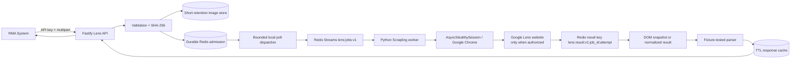

# Architecture

## Runtime flow



The Fastify API and bounded local poll dispatcher remain one deployable process.
Scrapling execution is an external Python worker; Redis Streams admission and
durable image/job storage keep browser work independent from HTTP request
lifetime and make accepted work recoverable after an API restart.

## Components

1. **HTTP layer** (`src/http/app.ts`) exposes the Google Lens search aliases,
   validates multipart bytes and search parameters, enforces API keys/rate
   limits, and keeps request bodies bounded.
2. **Image boundary** (`src/http/uploads.ts`, `src/storage/image-store.ts`)
   checks JPEG/PNG/WebP signatures, dimensions and pixel count, hashes bytes,
   and retains uploaded images only for a short configurable period. Production
   `FileImageStore` atomically writes `<image_id>` plus metadata beneath
   `IMAGE_STORAGE_DIR` and removes expired, over-limit, orphaned, or unsafe files.
3. **Remote URL boundary** (`src/services/remote-image.ts`) follows only
   bounded HTTP(S) redirects, rejects local, private, link-local, metadata,
   and IPv4-mapped private ranges before every fetch, and pins the validated
   DNS address into the corresponding HTTP connection.
4. **Queue/worker layer** (`src/queue`, `src/workers`) applies admission
   control, bounded retries with jitter, dead-letter metadata and cancellation.
    `InMemoryJobQueue` is the offline default. `RedisJobQueue` provides a
    central Redis list for legacy/local admission. `ScraplingDispatchQueue`
    publishes the accepted reference to `lens:jobs:v1` and keeps only a bounded
    local polling queue; TypeScript never consumes the Python worker's consumer
    group.
   `RedisJobPersistence` hydrates job/batch metadata and results with atomic
   terminal commits and cancellation markers. Cache hits are served before
   queue admission, and equivalent in-flight work is coalesced per principal.
   Multipart batches also have an aggregate `MAX_BATCH_BYTES` admission bound
   in addition to the image-count and queue limits.
 5. **Scrapling adapter/parser boundary** (`src/adapters`, `src/parser`) keeps browser
   interaction and normalized output independent. `ScraplingRedisAdapter`
    polls an overall timeout for an already-published dispatch, maps
    snapshots/results, and classifies challenge/timeout failures; dispatch IDs
    prevent a late retry result from winning. The mock adapter and sanitized
   fixtures are used for all offline tests.
 6. **Cache/metrics** (`src/services/cache.ts`, `src/services/metrics.ts`) use
   SHA-256 plus all result-affecting search parameters for TTL cache keys and
   emit Prometheus text counters and bounded percentile samples.

## Job state model

```text
queued -> running -> succeeded
                 \-> failed -> dead_letter metadata when retries exhausted
                 \-> queued (bounded retry with jitter)
queued/running -> cancelled
```

Every batch child has an independent ID and terminal state. A challenge is not
converted into an empty success. Aggregate batches expose `retry_pending` while
bounded retry work is waiting, `completed_with_errors` when at least one child
succeeds and another fails/cancels, and `failed` when all terminal children fail;
the child status payload preserves the exact error classification.

## Browser isolation and lifecycle

- The production API does not launch or manage a browser.
- The Python worker uses Scrapling `AsyncStealthySession` with installed Google
  Chrome and configurable `max_pages`.
- The worker keeps one Chrome session warm and opens a new page for each job.
  Reuse is never treated as a browser-context isolation guarantee.
- Increase `SCRAPLING_MAX_PAGES` only after measuring memory and proving that
  the pinned Scrapling session resets page state between jobs.
- The service supports authenticated residential and mobile proxy rotation (via `SCRAPLING_PROXY_URL`) with sticky sessions and dynamic challenge rotation; no third-party CAPTCHA solver or Google account profile is used.

## Deployment boundary

Redis is private to the Compose network and is never published to the host.
The API container runs as the unprivileged Node user with a read-only root
filesystem, a bounded `/tmp`, dropped Linux capabilities and resource limits.
TLS termination belongs at the existing reverse proxy. See
`docs/operations.md` for backup and rollback gates.
